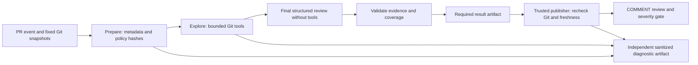

# Claude PR Review

A bounded GitHub PR reviewer that explores related code through read-only Git tools, publishes evidence-linked findings, and fails a check for high/critical defects. Merge blocking requires an independently configured required branch-protection rule.

**October 11, 2026 — v2 delivered and live smoke verified.** Three private review snapshots exercised cross-file defect detection, correction and a clean JavaScript refactor; an unchanged rerun reused the result with zero new model calls and no duplicate review. The paid workflow is disabled after the bounded smoke. Coverage was partial and false positives occurred; improved general review quality and private merge enforcement remain unverified. See the [live evidence and limitations](docs/v2-live-verification-2026-10-11.md). AI-assisted implementation and Julia's independent explanation remain separate evidence dimensions.

The private repository's historical v1 demonstration remains at `a89a22a39372f1cfc8f40448fa572be63fd7862e`: three Haiku reviews demonstrated clean/defect/fix, an inline finding, severity gating and duplicate-free reuse. Severity was over-calibrated; private merge-protection configuration returned HTTP 403. See the unchanged [v1 evidence](docs/live-verification-2026-10-05.md). These results do not establish v2 quality or enforcement.



## Local verification

```sh
python3 -m venv .venv
.venv/bin/python -m pip install -r requirements-lock.txt
.venv/bin/python scripts/run-tests.py
```

Verify remains credential-free on Python 3.10/3.12. The installed official SDK is exercised with mock HTTP transport, including token counting, tool-use messages, final JSON, and errors. No model call is needed to run the tests.

The historical offline example remains usable:

```sh
PYTHONPATH=src .venv/bin/python -m pr_review.cli analyze --input evaluation/input.json --recorded evaluation/clean-response.json --output outputs/result.json
PYTHONPATH=src .venv/bin/python -m pr_review.cli publish --input evaluation/input.json --result outputs/result.json --dry-run --output outputs/payload.json
```

For v2, `prepare --mode context` is the CLI default; `--mode diff` selects the paired baseline. Both bind model, PR metadata, snapshots and actual policy hashes. `analyze` accepts `--repository-path` for those immutable Git objects. `--recorded` validates authored responses offline; they cannot be published as live reviews. `analyze --cache-only` (or workflow variable `CLAUDE_CACHE_ONLY=true`) fails on a cache miss before provider initialization; it permits zero-paid rerun verification. Every command accepts `--diagnostics-dir` (default `outputs/diagnostics`). See [evaluation commands](docs/v2-evaluation.md) for generated case repositories and the separately authorized runner.

## Boundaries

- Analysis has repository/PR read permissions and the Anthropic secret. Publication has PR write permission and no provider credential. Both execute base-commit scripts; PR code is data. Separate Verify executes candidate tests without provider secrets.
- Events: opened, synchronize, reopened, ready_for_review and edited. Draft, fork, bot and non-main PRs have no review coverage. Contributors editing same-repository workflows must be trusted; this is not a hostile-contributor sandbox.
- Snapshots: `before` is merge base, `after` is PR head, `target` is base tip. Integration compatibility with current main belongs to Verify.
- Limits: 20 changed files, 60 KiB supported diff, four exploration calls and one final call, twelve tool operations, 24,000 input tokens, 2,000 exploration/4,000 final output tokens, 60 seconds/call, five minutes/analysis, zero SDK retries. Input admission additionally uses a conservative UTF-8 byte bound, so a PR below the diff limit can still exceed the request budget.
- Tools list permitted tracked files, perform literal text searches and read bounded line ranges. They do not execute code or provide a static dependency graph. Credentials, environment files, private keys, symlinks, submodules and generated/vendor/build content are excluded. Missing/denied/truncated context remains an application limitation.
- High/critical findings fail; valid complete or incomplete reviews without them succeed. Incomplete results prominently say **INCOMPLETE REVIEW** and emit a warning. Invalid final output/evidence, provider errors, stale snapshots or publication failure fail. Success with warning does not mean full coverage.
- Inline anchors must be in a displayed hunk. Related code is linked to immutable commits; findings without valid inline positions use the review body. Publication checks citation IDs, ranges, blob IDs and source hashes against Git.
- Cache identity includes snapshots, title/body, mode, model and actual policies. Execution timestamps/trace IDs are excluded. V1 cannot satisfy v2. The hidden cache record is at most 32 KiB and contains findings plus cited source metadata; full transcripts are diagnostic artifacts. A cache hit makes zero new paid calls and reports original usage separately.
- Publication performs one POST. An uncertain outcome triggers read-only reconciliation and never another POST in that invocation. A push/edit during publication can leave an old-commit review, but freshness checks fail the gate. No PR approval, merge or application submission is automated.
- Traces sanitize secrets before console/files/summary, omit authorization headers, hidden reasoning and raw SDK objects, and cap each job bundle at 10 MiB. Full available requests/responses belong in artifacts, not console. Retention is seven days. Redaction/truncation/interruption/upload failure prevents a completeness claim; hard runner loss is best effort.
- The pilot reserves at most $4 of a $5 ceiling across development, paired held-out runs and private smoke reviews. Failed/unknown calls retain their reservation. The final $1, publication and workflow activation require separate permission. Account-wide invoices are outside this application's guarantee.

## Guides and evidence

- [Architecture and contracts](docs/v2-architecture.md)
- [Troubleshooting and traces](docs/v2-troubleshooting.md)
- [Evaluation and authorized pilot runner](docs/v2-evaluation.md)
- [Offline walkthrough](docs/walkthrough.md)
- [V2 live verification and limitations](docs/v2-live-verification-2026-10-11.md)
- [V2 historical local acceptance and delivery package](docs/v2-delivery.md)

Technical references checked October 10, 2026: [Anthropic client tools](https://platform.claude.com/docs/en/agents-and-tools/tool-use/handle-tool-calls), [structured output](https://platform.claude.com/docs/en/build-with-claude/structured-outputs), [pricing](https://platform.claude.com/docs/en/about-claude/pricing), [GitHub reviews](https://docs.github.com/en/rest/pulls/reviews), and [workflow commands](https://docs.github.com/en/actions/reference/workflows-and-actions/workflow-commands). First-party Haiku 4.5 rates currently list $1 input/$5 output per million tokens; availability/pricing must be rechecked immediately before separately authorized live work. No Sonnet comparison or model substitution is included.
