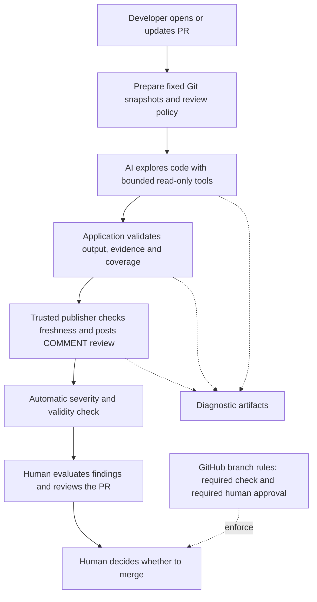

# Claude PR Review

An AI-assisted GitHub pull request reviewer that analyzes code changes, produces findings with source references, and reports a configurable review check.

*This portfolio proof of concept demonstrates AI-assisted code review. It is not a production service.*

## Quick Start

Use Python **3.10+**, Git and a Unix shell. Run from the project root:

```sh
python3 -m venv .venv
.venv/bin/python -m pip install -r requirements-lock.txt
.venv/bin/python -m pip uninstall -y setuptools
.venv/bin/python scripts/run-tests.py
PYTHONPATH=src .venv/bin/python -m pr_review.cli show-config
```

The runtime does not need setuptools; removing the virtual environment's optional bootstrap copy avoids retaining an unused build tool. Tests and `show-config` require no credentials or provider calls. For a local demonstration that produces a review payload without networking, follow the [offline walkthrough](docs/walkthrough.md). The [capability showcase](docs/showcase.md) exercises cross-file findings, a nonempty clean refactor and cache reuse using explicitly authored SDK responses.

To run on GitHub:

1. Create a `claude-review` GitHub Environment restricted to the `main` branch. Add `CLAUDE_REVIEW_PROVIDER_KEY` as an **environment secret**, then follow the [credential setup](docs/runtime-configuration.md#credential-and-workflow-trust).
2. Set repository **Variables** for the model and current input/output token prices, and choose a per-review budget. Preview the same settings locally with `show-config`.
3. Enable **Claude PR review** in Actions when ready to allow provider calls. Open or update an eligible same-repository PR targeting `main`.
4. Read the posted review and **Claude review gate** check. Use the run's diagnostic artifacts to investigate failures.
5. Configure required checks and required human approval in GitHub branch rules if merging must depend on both.

Confirm the repository permits `pull_request_target` under its Actions event policy; some public repositories block it by default. Enabling the review workflow permits paid provider requests. Repository variables apply to new runs; keep them stable during a run because publication revalidates the policy.

### Key Settings

| Repository variable | Purpose |
| --- | --- |
| `CLAUDE_MODEL` | Concrete Claude model ID; defaults to `claude-haiku-5-5`. |
| `CLAUDE_INPUT_USD_PER_MILLION`, `CLAUDE_OUTPUT_USD_PER_MILLION` | Operator-supplied token prices; required for a non-default model. Verify current prices before paid use. |
| `CLAUDE_MAX_REVIEW_USD` | Per-review token-cost reservation ceiling; defaults to `0.20` in context mode. |
| `CLAUDE_FAIL_SEVERITY` | Findings at or above this severity fail the check; defaults to `high`. |
| `CLAUDE_CACHE_ONLY` | Set to `true` to reuse an existing result without new model calls; a cache miss fails. |

For all settings, defaults, ranges and examples, see the [configuration reference](docs/runtime-configuration.md). To change the review instructions, edit [review-policy.md](src/pr_review/review-policy.md); a merged policy applies to subsequent reviews from that base branch.

## Capabilities

### Core Capabilities

- **Automated PR Review:** analyze proposed changes and publish findings with severity, explanation, source evidence and a suggested correction.
- **GitHub Feedback:** attach inline comments to changed lines where possible and report a configurable severity check.
- **Configurable Review Policy:** choose the Claude model, review instructions, failing severity and review budget.

### Extended Capabilities

- **Related-Code Exploration:** follow dependencies beyond the diff using read-only search and file tools over fixed Git snapshots.
- **Result Reuse:** recognize identical review inputs and reuse the result without another model call or duplicate GitHub review.
- **Offline Replay:** validate an authored response and inspect the generated review payload locally.

### Cross-Cutting Controls

- **Bounded Execution:** enforce tool, token, cost and time limits, with up to three retries for transient request failures.
- **Validated Evidence:** check structured findings, source identity, line ranges and snapshot freshness before publication.
- **Traceability and Isolation:** correlate diagnostic events and source references while separating analysis credentials from publication permissions.

## Main Use Case

A developer opens or updates a PR. The reviewer examines the change and relevant surrounding code, then posts findings and a check result. A human assesses those findings alongside tests and their own review before deciding whether to merge.

For example, changing a producer's response key can break a caller in an unchanged file. The reviewer can follow that relationship, cite the caller and attach a finding to the changed producer.

## Architecture



A `pull_request_target` workflow runs trusted orchestration. Analysis and publication run in separate jobs using trusted base-commit code. Analysis can read the repository and access the provider key. Publication can write a PR review and has no provider key. PR code is inspected as data; the review jobs do not execute it. Candidate tests run separately in Verify without provider credentials and with a read-only GitHub token. Repository administrators and maintainers who can change protected code/settings remain trusted.

## Human Oversight and AI Guardrails

The application automates analysis, validation, comments and the check result. It never submits an approving review or merges a PR. To make human review a mandatory gate, configure GitHub to require both **Claude review gate** and a human PR approval. These repository rules are separate from the workflow; a failed check alone does not prevent merging without an enforced rule.

The model proposes findings; application code enforces tool permissions, evidence contracts and execution limits. A human decides whether a finding is valid, what to change and whether the PR is ready. A passing check is advisory evidence, not a replacement for that decision.

Invalid output, stale snapshots, exhausted budgets and expired deadlines stop the review. Partial coverage is reported explicitly. The model cannot change code or expand its own permissions; changes to policy, credentials, budgets and merge rules remain operator decisions.

## Security and Data Handling

| Control | How it is applied |
| --- | --- |
| Restricted code access | Context tools read fixed, tracked Git blobs; deny credential-oriented paths, binary/non-regular objects and selected generated files; bound file sizes and line ranges. |
| Sensitive-content checks | Recognized token/private-key patterns and matching runtime-secret values are rejected in context reads. Input validation also checks recognized sensitive patterns before analysis. |
| Enforced tool permissions | The model can list files, search literal text and read bounded ranges. It cannot execute commands, modify files or choose arbitrary network tools. Repository text is treated as untrusted input. |
| Limited credentials | Trusted-base workflow code separates provider access from PR writes; checkout credentials are not persisted. Scope the provider secret to the restricted `claude-review` environment. |
| Validated publication | Schema, source identity, line ranges, policy identity and current PR snapshots are checked before a review is accepted for publication. |
| Bounded diagnostic retention | Traces apply pattern-based redaction, a 10 MiB bundle cap and seven-day Actions artifact retention. |

The diff and selected source text are sent to the configured provider. Restricted changed paths are rejected on both sides of the diff before analysis. Pattern checks/redaction are not comprehensive secret detection. Use only repository content cleared for external processing, and inspect retained diagnostics before sharing them. Tool restrictions limit what the model can do; they do not establish immunity to prompt injection.

## Engineering Decisions and Harness

The harness surrounds the model with deterministic checks and execution controls.

| Problem | Decision | Why this approach |
| --- | --- | --- |
| A branch can change while a review is running | Bind input and evidence to immutable Git snapshots; recheck freshness before and after publication | Findings remain attributable to specific code, and a stale result fails the check. |
| Model output can contain malformed findings or invented citations | Require structured output and validate cited blobs, source IDs and line ranges | Invalid output cannot become an accepted review. Human review still determines whether an interpretation is correct. |
| Exploration can consume unpredictable resources | Bound files, tools, requests, tokens and cost reservations; reserve capacity for the final response | Keep review effort within explicit limits and report omissions as partial coverage. |
| Transient failures and stalled operations need controlled recovery | Allow up to three retries for transient read and generation failures, with backoff, per-attempt cost reservations, operation timeouts and a total analysis deadline | Recover from temporary failures while bounding execution and accounting for uncertain paid attempts. See [runtime details](docs/architecture.md#execution-harness). |
| An uncertain publication response can cause duplicate comments | Attempt one review write, then reconcile through read-only requests | Avoid a blind second POST; unresolved outcomes require inspection. |
| Repeated PR events can repeat paid work | Bind cached results to snapshots, metadata, model and policy hashes | Reuse an identical result while invalidating it when review inputs change. |
| A passing check can be mistaken for complete coverage | Track coverage separately from severity | A partial review visibly reports **INCOMPLETE REVIEW**, even when no finding reaches the failing threshold. |
| Failures need investigation without another model call | Record correlated events, sanitized request/response data and source context | Support offline diagnosis and replay; manifests identify missing, redacted or truncated records. |

Implementation: [context tools](src/pr_review/context.py), [review orchestration and publication](src/pr_review/service.py), [diagnostics](src/pr_review/diagnostics.py). See the [architecture reference](docs/architecture.md) for detailed contracts.

## Operational Limits

The proof of concept deliberately limits its integration surface and review effort: same-repository PRs, read-only tools and bounded resource use keep the workflow focused and inspectable. The following boundaries matter when running it.

- The workflow covers non-draft, non-bot, same-repository PRs targeting `main`. Forks and other branches are outside its review coverage.
- Input admission allows ordinary textual patches, up to 20 changed files and a 60 KiB diff. Binary, mode-only, metadata-only, submodule and quoted-path changes fail admission. File/tool/token/time limits can produce partial coverage; a passing check is not a complete-clean certificate.
- Context mode is the main review path. The optional diff mode supplies bounded changed hunks without related-code exploration; omissions are reported as partial coverage.
- Cost controls use configured prices and conservative reservations; they are not an account-wide billing cap. An interrupted provider request may have unknown usage.
- Analysis uses Unix signals; Windows execution is unverified. Actions also imposes a ten-minute timeout per job.

## Verification and Further Reading

Offline tests cover Git snapshots, tool restrictions, evidence validation, SDK transport behavior, configuration, gating, cache reuse and publication races. Authored replay responses and transport mocks verify application contracts; broader model accuracy remains unmeasured.

- [Capability Showcase](docs/showcase.md) — synthetic SDK transport, real Git evidence and exact cache-rerun checks.
- [Offline Walkthrough](docs/walkthrough.md) — run the local replay and inspect its output.
- [Configuration](docs/runtime-configuration.md) — model, budget, depth and gate controls.
- [Troubleshooting](docs/troubleshooting.md) — diagnose a run from its artifacts.
- [Architecture](docs/architecture.md) — contracts, safeguards and implementation boundaries.
- [Evaluation](docs/evaluation.md) — synthetic cases, separate labels and comparison tooling.
