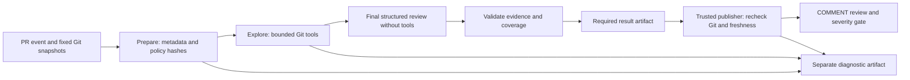

# Claude PR Review

A Python GitHub PR reviewer that explores related code through bounded read-only Git tools, validates evidence-linked findings, and fails a configurable severity check (high/critical by default). It addresses a limitation of diff-only review: a changed producer can break an unchanged consumer. This is a portfolio prototype with known security and correctness gaps, not a production security service. Merge blocking requires an independently configured required branch-protection rule.

## What it demonstrates

| Engineering capability | Implementation and evidence |
| --- | --- |
| Immutable Git snapshot reasoning | [Context reader](src/pr_review/context.py), [snapshot/context tests](tests/test-context.py) |
| Structured Python contracts and evidence validation | [V2 contracts](src/pr_review/v2.py), [citation/gate regressions](tests/test-v2.py) |
| SDK orchestration and failure handling | [Analysis/transport](src/pr_review/service.py), [installed SDK mock tests](tests/test-sdk.py) and [v2 protocol tests](tests/test-v2.py) |
| CI privilege separation | [Review workflow](.github/workflows/claude-review.yml), [workflow checks](tests/test-workflow.py) |
| Duplicate prevention and uncertain-write recovery | [Publisher](src/pr_review/service.py), [publisher tests](tests/test-service.py) |
| Evaluation boundaries and diagnostic traceability | [Evaluation runner](scripts/evaluate-v2.py), [evaluation tests](tests/test-evaluation-v2.py), [diagnostics tests](tests/test-diagnostics.py) |

## Representative outcome

The [October 11 live smoke](docs/v2-live-verification-2026-10-11.md) introduced a Python producer key change that broke an unchanged consumer. A validated high finding linked immutable source evidence, appeared inline, and failed the severity gate. Correction passed with partial coverage and an unsupported low finding. An unchanged cache-only rerun reused the byte-identical result with **zero new model calls and no duplicate review**. A separate clean JavaScript refactor also passed with partial coverage. False positives and the first failed attempt remain recorded; these observations do not establish general precision/recall or better held-out quality.

## Architecture



Analysis has repository/PR read permissions and the provider secret; publication has PR write permission and no provider credential. Both execute base-commit scripts; PR code is data. Candidate tests run separately in Verify without provider secrets. `before` is merge base, `after` is PR head, and `target` is base tip. Tools list tracked files, search literal text and read bounded line ranges; they do not execute PR code. Application tool restrictions are enforced; model resistance to prompt injection is unverified. Same-repository workflow contributors must be trusted.

## Engineering decisions

| Decision | Benefit and trade-off |
| --- | --- |
| Fixed snapshots, metadata and policy hashes | Reproducible evidence and conservative cache invalidation; an edit requires new inputs |
| Validate source IDs, blobs, hashes and ranges | Reject invented/mismatched citations; existence does not prove semantic correctness |
| Separate coverage from severity | Valid partial reviews can pass without findings at the configured failing threshold; success is not full coverage |
| Store compact result in review body | Cache reuse without transcripts; deleted reviews remove cache evidence |
| One publication POST, then read-only reconciliation | Avoid duplicate writes on uncertain outcomes; unresolved ambiguity requires inspection |
| Bound tools, requests and cost reservations | Constrain exploration and preserve a final-call allowance; may omit relevant code and leave unknown cost reserved |

See [architecture and current limits](docs/v2-architecture.md). Fixed admission limits include 20 changed files and 60 KiB diff. Configurable defaults are four exploration calls plus one final call, twelve tool operations and 24,000 input tokens/request. See the [User Guide](#user-guide) for ranges. Generation uses 60-second Unix signal timers, SDK timeouts and zero retries; elapsed-time checks target five minutes but do not guarantee a total deadline. Actions has a separate ten-minute job timeout.

## Prerequisites and verification

Python **3.10+**, Git, and a Unix shell are required for these commands. Local evidence uses macOS/Python 3.10.1; GitHub Verify has exercised Ubuntu/Python 3.10 and 3.12. Unix signals are used by analysis; Windows support is unverified. Run from the project root. Dependency installation needs package access; tests and the replay below require no credentials or provider calls.

```sh
python3 -m venv .venv
.venv/bin/python -m pip install -r requirements-lock.txt
.venv/bin/python scripts/run-tests.py
```

The pinned build dependency has an unresolved dated advisory; see limitations before treating installation as a security endorsement.

## User Guide

### Where to change settings

Open this repository on GitHub → **Settings → Secrets and variables → Actions → Variables → New repository variable** (or edit an existing one). Use **repository** variables: the workflow does not attach a GitHub Environment, so environment-scoped variables are not part of this interface. The workflow forwards the same settings to analysis and publication. No source edit or commit is needed for the variables below.

| Repository variable | Default | Accepted value / effect |
| --- | --- | --- |
| `CLAUDE_MODEL` | `claude-haiku-4-5-20251001` | Concrete Claude model ID; no model allowlist or fallback substitution |
| `CLAUDE_INPUT_USD_PER_MILLION` | Historical `1` for exact default model | Positive decimal input-token price; required for any other model |
| `CLAUDE_OUTPUT_USD_PER_MILLION` | Historical `5` for exact default model | Positive decimal output-token price; required for any other model |
| `CLAUDE_MAX_REVIEW_USD` | `0.20` context / `0.05` diff | Positive decimal per-review token-cost reservation ceiling |
| `CLAUDE_REVIEW_MODE` | `context` | `context` explores related code; `diff` uses the baseline with the open MD-01 limitations |
| `CLAUDE_FAIL_SEVERITY` | `high` | `low`, `medium`, `high`, `critical`, or `none`; findings at or above the threshold fail the gate |
| `CLAUDE_MAX_EXPLORATION_CALLS` | `4` | Integer `0`–`8`; extra research calls before the one final call, context mode only |
| `CLAUDE_MAX_TOOL_OPERATIONS` | `12` | Integer `1`–`100`; total tool operations per analysis |
| `CLAUDE_MAX_INPUT_TOKENS` | `24000` | Integer `4096`–`128000`; request admission/token-count limit, not a guarantee the provider supports that size |
| `CLAUDE_EXPLORATION_MAX_OUTPUT_TOKENS` | `2000` | Integer `1`–`16000`; output maximum per research call |
| `CLAUDE_FINAL_MAX_OUTPUT_TOKENS` | `4000` | Integer `1`–`16000`; output maximum for final structured review |
| `CLAUDE_CACHE_ONLY` | `false` | Exact `true` prohibits new model calls; cache miss fails. Use `false` for normal mode. |

Leave optional variables blank or delete them to restore defaults. Enum values are lowercase; numeric control values must be decimal integers without signs/spaces. Invalid settings fail configuration validation before provider use. `none` disables only severity-based failure: invalid evidence/output, provider failures, stale inputs and publication errors still fail. It does not disable validation or approve a PR. Zero research calls skips exploration and reports partial coverage.

### Change model, depth or gate policy

For a new model, set its concrete `CLAUDE_MODEL` ID and both current token prices. Use an ID available to your account supporting token counting, tool use and JSON-schema output. The ID goes unchanged to provider requests; unsupported models/features and returned-model mismatch fail rather than silently selecting Haiku. Compatibility with every ID is not established by offline tests. See [provider structured-output requirements](https://platform.claude.com/docs/en/build-with-claude/structured-outputs), consulted October 11, 2026.

Prices are operator-supplied estimates, not automatic price discovery. Verify them before paid use, even for the default model. A higher-cost model or deeper review may need a higher explicitly chosen `CLAUDE_MAX_REVIEW_USD`. Larger limits permit more work but cannot override the fixed time controls or guarantee complete coverage. The application reserves a worst-case final request before exploration; if the budget does not fit, it fails before sending that generation request. This is not an account-wide invoice guarantee.

For less exploration, set `CLAUDE_MAX_EXPLORATION_CALLS=2` and `CLAUDE_MAX_TOOL_OPERATIONS=6`. To fail on medium as well as high/critical findings, set `CLAUDE_FAIL_SEVERITY=medium`. These changes affect application policy; enforced GitHub required checks are still necessary to prevent merging. Do not use a passing partial review as a complete-clean certificate.

### Validate locally before a paid run

From the project root, use the same environment variables as GitHub:

```sh
PYTHONPATH=src .venv/bin/python -m pr_review.cli show-config
CLAUDE_MAX_EXPLORATION_CALLS=2 CLAUDE_MAX_TOOL_OPERATIONS=6 CLAUDE_FAIL_SEVERITY=medium PYTHONPATH=src .venv/bin/python -m pr_review.cli show-config
```

`show-config` prints effective model, budget settings, controls, cache-only switch, prompt and policy hashes as JSON, requires no credentials and makes no network calls. Exit 0 means the local configuration/prompt is valid; exit 2 means invalid settings. A null budget `max_cost` means use the mode default in the table. This does not verify live model availability or current prices. The workflow also runs this validation before preparing a review.

`prepare --model` and `prepare --mode` override the corresponding environment defaults for that preparation. Keep the same effective settings for analysis/publication. The evaluation tool prepares both modes; set the same model/controls when preparing, freezing and executing a comparison. See [evaluation guide](docs/v2-evaluation.md).

### Edit the review instructions

The v2 prompt is [review-policy.md](src/pr_review/review-policy.md), a plain Markdown file shipped with the Python package. Edit it through GitHub's file editor or locally, review the change in a PR, and merge it into the base branch. No Python edit is needed. It must be nonempty UTF-8 and at most 32 KiB. The workflow reads the file from its trusted base checkout; a PR changing the prompt is reviewed with the prior base version. The new prompt applies after merge. The historical v1 prompt remains unchanged.

Instructions guide the model; application code still enforces schemas, evidence validation, allowed tools, snapshot freshness and fixed resource guardrails. Changing prose does not bypass these checks.

### When changes take effect and where to inspect them

Variables apply to a new eligible workflow run and do not change existing reviews or an in-flight request. Keep them unchanged during a run: publication revalidates the configuration. Model, effective controls/prices, prompt and actual implementation participate in policy/cache identity. Changed review-policy settings require fresh preparation and prevent reuse of old results. The execution-only `CLAUDE_CACHE_ONLY` switch is deliberately excluded from identity so it can reuse the same review. Inspect `show-config` in the Actions console and the analysis diagnostic `configuration` event for effective settings (`mode` is the actual run mode; `controls.mode` is its preparation default); prompt/policy hashes appear in prepared input and manifests.

Store the provider key only in `ANTHROPIC_API_KEY` under **Secrets**, never Variables or the prompt. `GITHUB_TOKEN` is supplied automatically by Actions. Editing variables does not activate the disabled paid workflow. Workflow activation and live execution are separate operator actions.

Fixed controls still include changed-file/diff size, allowed tool types and file exclusions, source validation, generation/time controls, zero SDK retries and job timeout. The separate historical evaluation aggregate ceiling is not controlled by these per-review settings. The known security, diff, deadline and dependency findings below remain open.

## Complete offline v2 example

Prepare development fixtures, validate an **authored clean response**, and generate a GitHub payload without networking:

```sh
.venv/bin/python scripts/evaluate-v2.py prepare --split development --output outputs/v2-demo
PYTHONPATH=src .venv/bin/python -m pr_review.cli analyze --input outputs/v2-demo/development-02/context-input.json --repository-path outputs/v2-demo/development-02/repository --recorded evaluation/v2/authored-clean-response.json --output outputs/v2-demo/result.json --diagnostics-dir outputs/v2-demo/analyze-diagnostics
PYTHONPATH=src .venv/bin/python -m pr_review.cli publish --input outputs/v2-demo/development-02/context-input.json --result outputs/v2-demo/result.json --dry-run --output outputs/v2-demo/payload.json --diagnostics-dir outputs/v2-demo/publish-diagnostics
```

All three commands return **0**. Preparation creates three disposable Git repositories, paired `context-input.json`/`diff-input.json` and local-only `case-record.json` files. Development case 02 is a valid independent configuration change. Its snapshots and policy identities are generated locally, not hardcoded. Held-out labels are never model/example input.

Inspect `result.json` and `payload.json`. Selected expected fields (synthetic replay, not live model output):

```json
{
  "version": 2,
  "live": false,
  "calls": 0,
  "coverage": "complete",
  "gate_outcome": "success",
  "sources": [],
  "usage": {"input_tokens": 0, "output_tokens": 0}
}
```

The payload has `event: "COMMENT"`, `commit_id` equal to the generated input's head, and `comments: []`. Empty sources are intentional: only cited metadata is retained, and this response has no findings. Diagnostic directories contain context, events, a manifest and empty request/response files for this replay; it does not create SDK calls.

For the supported evidence-linked finding path, [the v2 tests](tests/test-v2.py) construct a changed `contract.py` and unchanged `caller.py`. `finding()` derives a reference from the actual after-snapshot source, including its generated source ID/blob and lines 1–2. `test_body_only_finding_and_inline_anchor` verifies an immutable caller link and an inline RIGHT anchor at `contract.py:1`; `test_partial_success_high_still_fails` verifies the high gate. The [live finding](docs/v2-live-verification-2026-10-11.md#what-the-live-experiment-proved) supplies separate provider evidence. Neither authored examples nor mocks measure model accuracy.

`analyze` returns 0 after valid result creation even for a high finding. `publish --dry-run` returns 0 for a passing gate, 1 for findings at the configured failing threshold, or 2 for invalid input/result. It never posts a review. Recorded results cannot be published live. Fixture preparation refuses an existing case directory: for another run choose a fresh output path and use it consistently; do not delete real work. Generated outputs remain under ignored `outputs/`. Source edits can change policy hashes: regenerate inputs after such edits.

## Verification layers

| Layer | What it establishes | Limit |
| --- | --- | --- |
| Deterministic Git/contract/CLI tests | Snapshot identity, evidence validation, gating, races, cache and payload behavior | Authored/fake responses do not measure model accuracy |
| Installed SDK with in-memory HTTP | Serialization, tool-use pairing, final schema, errors and zero retry | No provider availability or live quality claim |
| Development/held-out evaluation tooling | Separate labels, sealed policies, conservative ledger and adjudication reports | Paired held-out study and independent oracle review remain unperformed |
| Historical live v1 and v2 smoke | Actual publication, defect/correction observations and cache reuse | Small sample, partial coverage, false positives; merge enforcement unverified |

## Repository map and guides

- `src/pr_review/`: contracts, context tools, orchestration, publication, CLI and diagnostics.
- `tests/`: deterministic regressions and SDK transport mocks; `scripts/run-tests.py` is the test entry point.
- `evaluation/`: authored v1 replay and v2 synthetic cases with separate labels; `scripts/evaluate-v2.py` prepares/seals/reports and has a separately authorized paid adapter.
- `examples/context-smoke/`: independent live-smoke producer/consumer fixtures; `.github/workflows/`: Verify and review jobs.
- [Architecture](docs/v2-architecture.md), [offline walkthrough](docs/walkthrough.md), [evaluation](docs/v2-evaluation.md), [troubleshooting](docs/v2-troubleshooting.md).
- [Development history](docs/development-history.md), [v1 results](docs/live-verification-2026-10-05.md), [v2 results](docs/v2-live-verification-2026-10-11.md), [historical local delivery](docs/v2-delivery.md), [operator delivery](docs/github-delivery.md), [historical smoke plan](docs/v2-smoke-plan.md).

## Limitations

- **Open M-01:** context filename/pattern/runtime-secret checks are bounded. The raw diff bypasses context path exclusions; credential URLs and quoted serialized password fields can reach provider token counting, and some can survive diagnostics. Redaction does not prove no raw sensitive data is transmitted. Do not rely on this tool to protect secrets.
- **Open MD-01:** diff mode reads a continuous displayed-line span capped at 200 lines per side, including unchanged gaps and omitting later citable hunks. It can incorrectly report complete coverage. Do not claim a valid exact hunk-only quality comparison.
- **Open MD-02:** token-count preflight and blocking Git reads can exceed the intended total deadline.
- **Open MD-03:** setuptools 80.9.0 has [GHSA-h35f-9h28-mq5c](https://github.com/pypa/setuptools/security/advisories/GHSA-h35f-9h28-mq5c), identified October 11, 2026, concerning sdist filename exclusion on macOS. No reviewer-runtime exploit was established; pins are unchanged in this documentation pass.
- **L-01 follow-up / open L-04:** selected operational limits now share validated configuration; fixed timer literals still need consolidation. Incomplete `.env` variant ignore defaults remain uncorrected.
- Draft, fork, bot and non-main PRs have no coverage. Missing/denied/truncated context remains a limitation. Evidence integrity does not establish correctness; valid partial reviews below the configured failing threshold pass with an **INCOMPLETE REVIEW** warning.
- Traces use bounded redaction and a 10 MiB bundle cap, with seven-day Actions retention. Redaction, truncation, interruption or upload failure prevent an exact completeness claim. Hard runner loss is best effort.
- Cost reservations, using operator-configured rates, constrain this application's attempted model-token use; they are not an account-wide invoice guarantee. Historical Haiku pricing and personal pilot allocations are dated experiment assumptions, not current prices or authorization. New paid work requires explicit operator authorization and pricing verification.
- The paid workflow was disabled after the October 11 bounded smoke; no ongoing paid use is enabled. Public release readiness, general accuracy and enforced private merge blocking remain unverified. No PR approval or merge is automated.

## Contribution and project boundary

Julia directed project scope and bounded verification/release decisions, including the defect/correction/clean scenarios and the review of limitations. Implementation and repository verification were AI-assisted. The [development history](docs/development-history.md) and dated live reports identify delivered behavior and observed limits. Repository quality does not establish unaided Python implementation or independent interview explanation.
