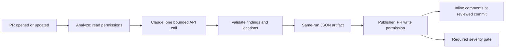

# Claude PR Review

A focused GitHub Actions integration: open a pull request or push a new commit,
receive Claude findings on diff lines, and block merge for high/critical findings.

**Status — October 4, 2026:** implemented and tested locally; Julia authorized
publication to a private GitHub repository. Live Claude calls, GitHub PR reviews
and branch-protection enforcement have not been demonstrated for this project.
Authored replay responses demonstrate software behavior, not model quality.
The implementation was developed with AI assistance; Julia's independent explanation
is a separate evidence gate.



## Run locally

The Python package is `pr_review`; the executable and project name remain
`claude-pr-review`.

Python 3.10+ on macOS/Linux. The live CLI uses a POSIX wall-clock timer and runs
in the main thread; GitHub uses Ubuntu and Python 3.12.

```bash
python3 -m venv .venv
.venv/bin/python -m pip install -r requirements-lock.txt
.venv/bin/python scripts/run-tests.py
```

The test runner explicitly loads kebab-case filenames and fails on zero tests.
Without installed SDK dependencies, SDK tests skip; the verified local release
uses the locked environment with no skips.

Replay a known defect and generate the exact publication payload:

```bash
PYTHONPATH=src .venv/bin/python -m pr_review.cli analyze \
  --input evaluation/input.json --recorded evaluation/defect-response.json \
  --output outputs/defect-result.json
PYTHONPATH=src .venv/bin/python -m pr_review.cli publish \
  --input evaluation/input.json --result outputs/defect-result.json \
  --dry-run --output outputs/defect-payload.json
```

The second command intentionally exits **1**: the authored high-severity finding
blocks the gate. Repeat with `evaluation/clean-response.json` and new output names
to obtain exit **0**. A recorded result cannot be sent to GitHub.

CLI: `prepare` collects a real PR snapshot from GitHub and a local Git object
database; `analyze` calls Claude or replays an authored response; `publish`
revalidates the snapshot, posts a review, and returns the gate verdict. Live
publication requires `--event "$GITHUB_EVENT_PATH"`; `--dry-run --output ...`
never sends a request. Exit 2 denotes invalid input, unavailable/incomplete review,
stale snapshot, missing configuration or publication failure.

## GitHub setup

Follow [the delivery package](docs/github-delivery.md) for the authorized private
publication and the separately proposed live experiment. Publish the complete
source to `main` first so both review jobs
can check out the scripts from the trusted base commit.

1. Set repository secret `ANTHROPIC_API_KEY` through GitHub Settings. Never put the
   key in a command argument, repository file or PR. The runtime uses the default
   `GITHUB_TOKEN`; no personal GitHub token is required by the application.
2. Set repository variable `CLAUDE_MODEL` to an explicitly verified, available
   model ID. The initial candidate is `claude-haiku-4-5-20251001`; no fallback is
   allowed. Confirm availability immediately before the authorized demonstration.
3. Enable Actions and “Allow GitHub Actions to create and approve pull requests”
   where needed for review submission. Job permissions remain limited to those
   in the workflow; no code-writing job exists.
4. After the checks have run, create an active rule for `main` requiring pull
   requests, **Claude review gate**, and the two Verify test checks. Require the
   branch to be up to date. Remove bypass actors for the demonstration and test
   as the actual maintainer. A red check alone does not prohibit merging.

Review runs on `opened`, `synchronize`, `reopened`, and `ready_for_review` PR events
to `main`. Forks, draft PRs and bot-authored PRs are explicitly outside v1 review
coverage; their gate is skipped with an explanatory successful job. They do not
receive a model call. Push without a PR runs ordinary verification only.

## Contracts and boundaries

- Analyze has `contents: read`, `pull-requests: read` and the Anthropic secret.
  Publisher has `contents: read`, `pull-requests: write` and no Anthropic secret.
- Both jobs execute base-commit scripts and use PR head objects only as data. The
  separate Verify workflow executes candidate tests without provider credentials.
- Same-repository contributors must be trusted to edit workflows. `pull_request`
  workflows themselves can be changed in a PR; checking out base scripts does not
  turn this into a sandbox for hostile collaborators. Fork support is excluded.
- The diff uses Git's merge base, not a direct comparison against the base tip.
  Textual changes support old/new diff sides and edited renames. Binary, symlink,
  executable-mode, metadata-only rename and quoted-path changes fail explicitly.
- Limits: 20 files, 60 KiB diff, 10 findings, 4,000 output tokens, one 60-second
  model call, zero SDK retries. Size rejection or partial output is never green.
  No automatic retry or silent model substitution exists. Each new snapshot or
  explicit retry after a failed call can incur another charge. Console limits,
  not this application, control total account spending across workflow runs.
- Review severity `high`/`critical` fails the required gate. `low`/`medium` do not.
  Claude uses `COMMENT`, not `APPROVE` or `REQUEST_CHANGES`. False positives can
  block a PR; a human must inspect the finding. AI findings do not replace tests.
- Per-PR workflow concurrency is serialized. A digest covers repository, PR,
  base/head/merge-base, diff, model and config version. A bot-authored review stores
  its result in a hidden body record; reruns reuse it before calling Claude.
  Bump `CONFIG` whenever prompt/schema/limits or decision policy change.
- Snapshot checks run before the model call and before/after publication. GitHub
  cannot atomically compare PR head and post a review: a push during that small
  window can produce a review on an older commit, but the gate fails and the
  review always names that commit. New commits receive a new review.
- An ambiguous POST triggers a read-only reconciliation, never another POST in
  that invocation. Submitted matching results are reused; pending/inconsistent
  states require inspection. Deleted bot reviews remove the durable cache.
- Source diffs go to Anthropic; JSON artifacts retain source and findings for seven
  days on GitHub. Only nonsensitive demo code belongs in this repository.

## Evidence and explanation

See [local verification](docs/local-verification.md), [delivery and live scenarios](docs/github-delivery.md),
and [the walkthrough](docs/walkthrough.md). Live PR/run URLs and measured accuracy
remain **Unknown** until the authorized experiment is complete. The earlier AI
Pipeline's results are not evidence of this project's live behavior.

## Technical sources

Checked October 3, 2026: [GitHub review API](https://docs.github.com/en/rest/pulls/reviews),
[PR events](https://docs.github.com/en/actions/reference/workflows-and-actions/events-that-trigger-workflows),
[secure Actions use](https://docs.github.com/en/actions/reference/security/secure-use),
[Claude structured outputs](https://platform.claude.com/docs/en/build-with-claude/structured-outputs),
[models](https://platform.claude.com/docs/en/models/overview),
and [SDK 1.11.0](https://pypi.org/project/anthropic/1.11.0/).
The SDK was also exercised locally through an in-memory HTTP transport without
a credential or network call. Direct and transitive runtime dependencies are
version-pinned in `requirements-lock.txt`; artifact hashes are not pinned.
